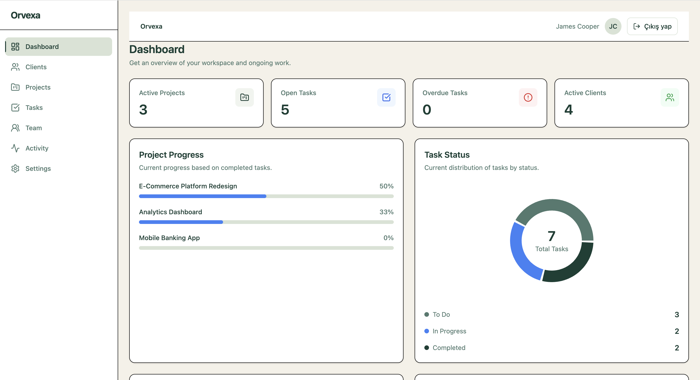
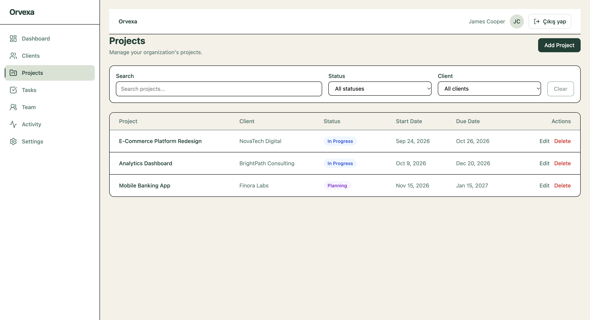
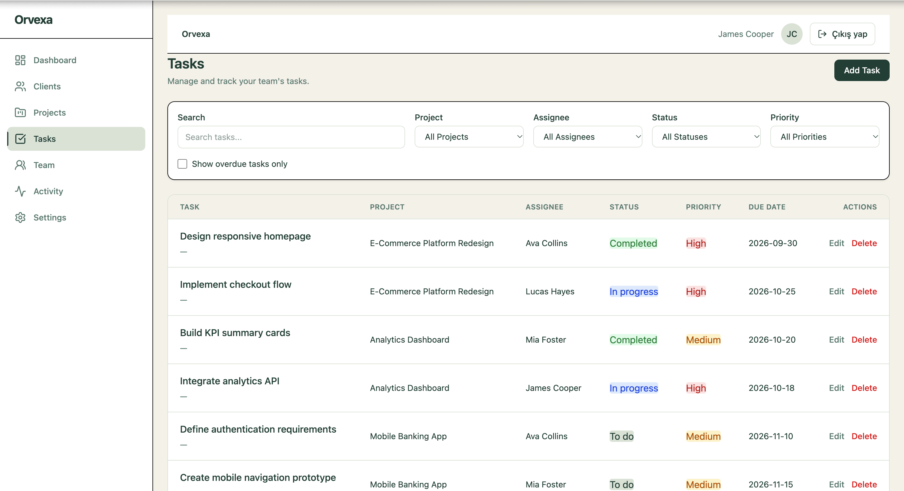
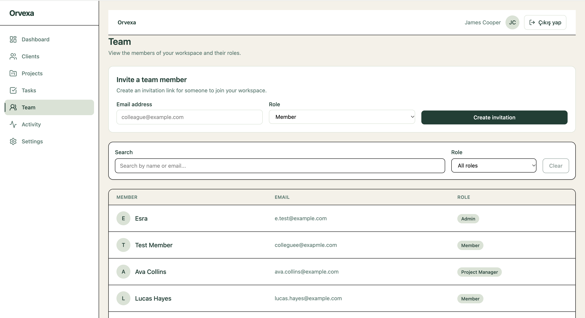

# Orvexa

Orvexa is a project management web application designed to help teams manage projects, tasks, clients, and team members in one workspace. It consists of a React and TypeScript frontend and a Spring Boot REST API.

**Live Demo:** [https://orvexa-gsz3.onrender.com](https://orvexa-gsz3.onrender.com)
**Source Code:** [https://github.com/esrakonya/orvexa](https://github.com/esrakonya/orvexa)

## Screenshots

| Dashboard | Projects |
| --- | --- |
|  |  |

| Tasks | Team |
| --- | --- |
|  |  |

More screenshots are available in [`docs/screenshots`](docs/screenshots).

## Features

- **Authentication:** user registration, login, session management, and logout
- **Dashboard:** project progress, task status summaries, upcoming tasks, and recent activity
- **Project management:** create, view, update, delete, and filter projects
- **Task management:** create, view, update, delete, and filter tasks
- **Client management:** manage client information and related details
- **Team management:** workspace membership and team invitation interface
- **Activity feed:** view recent activity
- **Settings:** workspace settings interface

Orvexa is under active development. Feature availability in the deployed application depends on the backend and database being configured and reachable.

## Tech Stack

### Frontend
- React 19
- TypeScript
- Vite
- Tailwind CSS 4
- React Router
- Recharts
- Lucide React

### Backend
- Java 21
- Spring Boot 4
- Spring Web MVC
- Spring Security
- Spring Data JPA
- Flyway database migrations
- Bean Validation

### Database and Development Tools
- PostgreSQL
- Docker
- Docker Compose
- Maven

## Project Structure

```text
orvexa/
├── src/
│   ├── api/                     # API request handling
│   ├── components/              # Reusable UI components
│   ├── contexts/                # React contexts, including authentication
│   ├── pages/                   # Application pages
│   ├── services/                # Frontend service layer
│   └── ...
├── backend/
│   ├── src/main/java/           # Spring Boot application
│   ├── src/main/resources/      # Configuration and database migrations
│   ├── Dockerfile
│   ├── compose.yaml             # Local PostgreSQL service
│   └── test.sh                  # Backend test script
├── docs/
│   └── screenshots/
└── package.json
```

## Getting Started

### Prerequisites

- Node.js and npm
- Java 21
- Docker with Docker Compose

### 1. Configure the database

From the repository root, create a `backend/.env` file:

```dotenv
DB_NAME=orvexa_db
DB_USERNAME=orvexa
DB_PASSWORD=change-this-local-password
```

Use a suitable local password. Do not commit credentials or production secrets.

Start PostgreSQL:

```bash
cd backend
docker compose up -d
```

The database schema is managed by Flyway when the backend starts.

### 2. Run the backend

From the `backend/` directory, load the environment variables and start the Spring Boot application:

```bash
set -a
source .env
set +a
./mvnw spring-boot:run
```

The backend uses port `8080` by default. Its default local database URL is:

```text
jdbc:postgresql://localhost:5432/orvexa_db
```

### 3. Run the frontend

Open a separate terminal and navigate to the repository root:

```bash
cd ~/orvexa
npm install
npm run dev
```

Open [http://localhost:5173](http://localhost:5173).

During local development, Vite proxies requests under `/api` to the backend at `http://localhost:8080`.

## Testing and Code Quality

Run the frontend lint checks:

```bash
npm run lint
```

Build the frontend for production:

```bash
npm run build
```

Run the backend test script:

```bash
cd backend
./test.sh
```

## Deployment

### Frontend

The frontend is deployed on Render:

[https://orvexa-gsz3.onrender.com](https://orvexa-gsz3.onrender.com)

### Backend

The repository includes `backend/Dockerfile` for building and running the Spring Boot application in a container. The Docker image enables the `prod` Spring profile.

The backend production configuration supports these environment variables:

| Variable | Purpose |
| --- | --- |
| `DB_URL` | PostgreSQL JDBC connection URL |
| `DB_USERNAME` | Database username |
| `DB_PASSWORD` | Database password |
| `PORT` | Server port; defaults to `8080` |

The backend and database must be deployed and configured for API-backed features to work in production. Cross-origin requests, session cookies, and CSRF protection must also be configured correctly for the deployed frontend and backend origins.

## Project Status

Orvexa is an ongoing full-stack project. The repository documents the current implementation and setup; not every feature should be assumed to be fully operational in the public deployment.